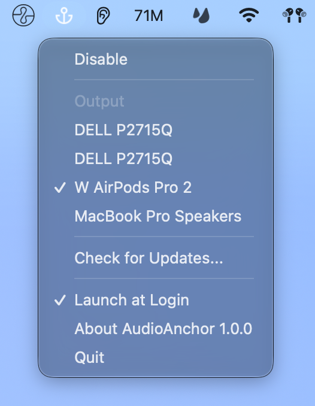

# AudioAnchor

A Mac menu bar app that keeps your sound output on the device you choose.

With AirPods automatic switching, your AirPods can move to your iPhone, and the next time you play something on your Mac it comes out of the built-in speakers instead. Plugging in a display or another audio device can move the output too. AudioAnchor lets you anchor the output to one device, like your AirPods, and switches it back whenever macOS moves it somewhere else.

**[Download the latest version](https://github.com/wata/AudioAnchor/releases/latest)** — signed and notarized, with automatic updates.

## Features

- **Anchor to one output device**: pick it from the menu bar. When another output starts playing or the list of devices changes, AudioAnchor switches the output back to your device.
- **Sound effects follow too**: both the main output and the output for alerts and sound effects are switched.
- **Brings back Bluetooth devices**: if your anchored device is a paired Bluetooth device that isn't connected, for example AirPods that went to your iPhone, AudioAnchor asks your Mac to connect to it.
- **Disable anytime** from the menu, without losing your choice. While disabled, choosing a device in the menu still switches to it once.
- Launch at Login.
- Free and open source. No account, no analytics.

## Requirements

macOS 13 or later.

## Usage

Download the latest pre-built application binary from Releases page and move it to `/Applications`. AudioAnchor checks for updates automatically, and you can also choose Check for Updates... from its menu.

Click the anchor icon in the menu bar and choose a device under Output. Choose it again to stop anchoring. Devices are matched by name. To be reconnected automatically, a Bluetooth device must already be paired with your Mac. macOS may ask for Bluetooth access the first time.

AudioAnchor only sets the system-wide default output. It does not route individual apps to different devices.

If you are using 0.1.x, it will not update to 1.0 or later automatically. Please download the latest version from Releases page manually.

## Development

- `./scripts/install.sh` builds a Release build and replaces `/Applications/AudioAnchor.app` with it (`--no-launch` to skip launching).
- `./scripts/release.sh <version> [--notes <file>]` bumps the version, builds a notarized zip, updates `appcast-v1.xml`, and publishes a GitHub Release. Use `--no-publish` to stop before committing.

## License

MIT
