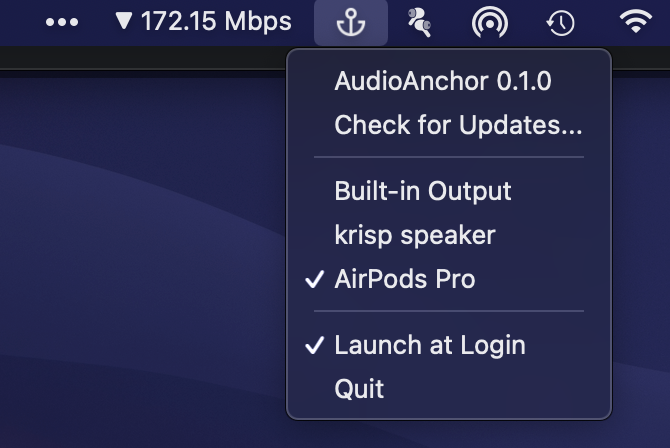

# AudioAnchor

A simple Mac app to fix sound output to a selected device.

For example, when AirPods' automatic switching is enabled, if you try to play music on your MacBook again after it has been switched from MacBook to iPhone, the music will be played from the Built-in Output.

By selecting AirPods as your audio output device, your MacBook's audio output device will always be fixed to AirPods and music will always play from AirPods as long as they are connected via Bluetooth.

## Requirements

macOS 13 or later.

## Usage

Download the latest pre-built application binary from Releases page. Note that these pre-built application binaries are not notarized, so you need to allow them to run in System Settings > Privacy & Security.

If you are using 0.1.x, it will not update to 1.0.0 automatically. Please download 1.0.0 from Releases page manually.

## Development

- `./scripts/install.sh` builds a Release build and replaces `/Applications/AudioAnchor.app` with it (`--no-launch` to skip launching).
- `./scripts/release.sh <version> [--notes <file>]` bumps the version, builds a zip, updates `appcast-v1.xml`, and publishes a GitHub Release. Use `--no-publish` to stop before committing.
